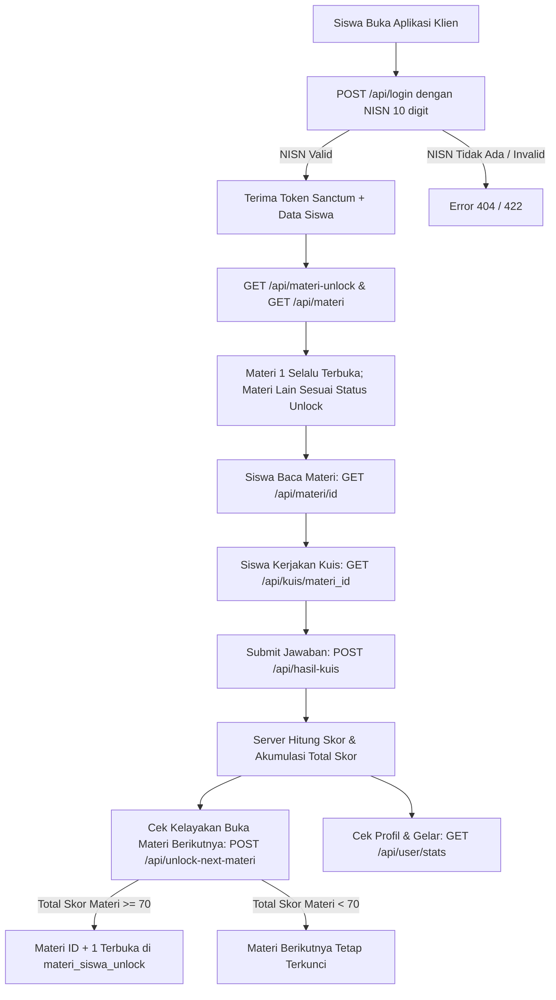

# Dokumentasi Proyek, Workflow, dan PRD — Backend Media Pembelajaran Matematika (SMPN 1 Merawang)

---

## 1. Deskripsi Proyek

### 1.1 Ringkasan Umum
Repository ini adalah aplikasi **backend dan panel admin berbasis web** yang dibangun menggunakan framework **Laravel 11 (PHP ^8.2)** untuk mendukung platform media pembelajaran interaktif mata pelajaran **Matematika** (dengan branding panel admin **SMPN 1 Merawang**).

Aplikasi ini memiliki dua peran utama dalam satu codebase:
1. **Panel Admin Web (Blade + AdminLTE 3):** Digunakan oleh admin/guru untuk mengelola data siswa, materi pembelajaran, soal kuis beserta pembahasannya, memantau riwayat pengerjaan kuis siswa, serta melihat leaderboard dan gelar pencapaian siswa.
2. **REST API (Laravel Sanctum):** Digunakan oleh aplikasi klien (mobile/frontend siswa) untuk autentikasi siswa berbasis NISN, mengakses daftar dan detail materi pembelajaran, mengerjakan kuis per materi, mendapatkan umpan balik skor & total skor, membuka materi berikutnya secara bertahap (*progressive unlock*), serta melihat profil dan gelar (*gamification*).

---

### 1.2 Tech Stack
- **Backend Framework:** Laravel Framework `^11.31` (PHP `^8.2`)
- **API Authentication:** Laravel Sanctum `^4.1` (Token-based authentication untuk siswa)
- **Web Admin Authentication:** Custom Session-based Authentication (`UserModel` pada tabel `data_user`, middleware `LoggedIn` & `LoginCheck`, rule `App\Rules\LoginCheck`)
- **Frontend Admin Panel:** Blade Templates, AdminLTE 3 (`public/template`), Bootstrap 4, DataTables, FontAwesome, Google Fonts (`Inter`)
- **Frontend Tooling (Vite):** Tailwind CSS `^3.4.13`, Vite `^6.0.11`, Axios `^1.7.4`
- **Testing:** PHPUnit `^11.0.1`, Mockery, Faker

---

### 1.3 Struktur Direktori Utama
```text
├── app/
│   ├── Http/
│   │   ├── Controllers/
│   │   │   ├── Api/
│   │   │   │   └── AuthController.php      # Endpoint REST API untuk aplikasi siswa
│   │   │   ├── MateriController.php        # CRUD Materi (Web Admin)
│   │   │   ├── UserController.php          # Auth Admin, Dashboard, CRUD Siswa (Web Admin)
│   │   │   └── quizController.php          # CRUD Kuis, Hasil Kuis, Riwayat, Leaderboard (Web Admin)
│   │   ├── Middleware/
│   │   │   ├── LoggedIn.php                # Proteksi route admin (harus login)
│   │   │   └── LoginCheck.php              # Redirect jika admin sudah login
│   ├── Models/
│   │   ├── UserModel.php                   # Tabel `data_user` (Admin)
│   │   ├── Siswa.php                       # Tabel `data_siswa` (Siswa + HasApiTokens)
│   │   ├── Materi.php                      # Tabel `materis`
│   │   ├── Kuis.php                        # Tabel `kuis`
│   │   ├── HasilKuis.php                   # Tabel `hasil_kuis`
│   │   └── MateriSiswaUnlock.php           # Tabel `materi_siswa_unlock`
│   └── Rules/
│       └── LoginCheck.php                  # Validasi email & password admin ke session
├── database/
│   └── migrations/                         # Skema tabel database
├── resources/views/
│   ├── admin/                              # Layout, login, dashboard admin
│   ├── User/                               # CRUD tampilan data siswa
│   ├── materi/                             # CRUD tampilan materi
│   ├── quiz/                               # CRUD tampilan kuis
│   ├── hasilkuis/                          # Daftar siswa & riwayat pengerjaan kuis
│   └── skorhasil/                          # Leaderboard & gelar siswa
└── routes/
    ├── web.php                             # Route Web Admin Panel
    └── api.php                             # Route REST API Siswa
```

---

### 1.4 Skema Database & Relasi Entitas

1. **`data_user`** (`UserModel`)
   - `id` (PK), `nama`, `no_hp`, `email` (unique), `password`, `timestamps`
   - Menyimpan akun administrator/guru untuk login ke panel admin web.

2. **`data_siswa`** (`Siswa`)
   - `id` (PK), `nama`, `nisn` (integer, unique, 10 digit), `kelas`, `timestamps`
   - Menggunakan trait `HasApiTokens` (Sanctum) untuk autentikasi API siswa.
   - Relasi: `hasMany(HasilKuis::class)`.

3. **`materis`** (`Materi`)
   - `id` (PK), `judul`, `konten` (text), `gambar` (nullable, path di `storage/app/public/materi_gambar`), `timestamps`
   - Relasi: `hasMany(Kuis::class)`.

4. **`kuis`** (`Kuis`)
   - `id` (PK), `pertanyaan` (text), `jawaban_a`, `jawaban_b`, `jawaban_c`, `jawaban_d`, `jawaban_benar` (`enum('a','b','c','d')`), `nilai` (integer), `materi_id` (FK -> `materis.id` cascade), `pembahasan` (digunakan di model & controller), `timestamps`
   - Relasi: `belongsTo(Materi::class)`, `hasMany(HasilKuis::class)`.

5. **`hasil_kuis`** (`HasilKuis`)
   - `id` (PK), `siswa_id` (FK -> `data_siswa.id` cascade), `kuis_id` (FK -> `kuis.id` cascade), `jawaban_user`, `skor` (integer), `waktu_dikerjakan` (timestamp), `timestamps`
   - Relasi: `belongsTo(Siswa::class)`, `belongsTo(Kuis::class)`.

6. **`materi_siswa_unlock`** (`MateriSiswaUnlock`)
   - `id` (PK), `siswa_id` (FK -> `data_siswa.id` cascade), `materi_id` (FK -> `materis.id` cascade), `timestamps`
   - Menyimpan daftar materi yang sudah terbuka (*unlocked*) untuk masing-masing siswa.

7. **`personal_access_tokens`** (Sanctum)
   - Menyimpan bearer token API untuk sesi login siswa.

---

## 2. Workflow Aplikasi

### 2.1 Workflow Panel Admin (Web)
1. **Autentikasi Admin:**
   - Admin membuka `/` atau `/login` (`admin.login`).
   - Mengirim `email` dan `password` ke `POST /loginproses`.
   - `App\Rules\LoginCheck` memverifikasi email di `data_user` dan `Hash::check` pada password. Jika valid, session `loginStatus = true` dan `ambilUser` disimpan.
   - Middleware `LoggedIn` menjaga seluruh route admin; `LoginCheck` mencegah admin yang sudah login kembali ke halaman login.
2. **Dashboard:**
   - Admin diarahkan ke `/admin/dashboard` yang menampilkan statistik ringkas: Total Siswa, Total Materi, Total Kuis, serta materi terbaru.
3. **Manajemen Data Siswa (`/dataSiswa`):**
   - Admin dapat melihat daftar siswa, menambah siswa baru (`nama`, `nisn` 10 digit, `kelas`), mengedit data siswa, atau menghapus siswa.
4. **Manajemen Materi (`/materi`):**
   - Admin dapat melihat daftar materi, menambah materi (`judul`, `konten`, upload `gambar` opsional max 2MB format jpg/jpeg/png), mengedit materi (otomatis menghapus gambar lama jika diganti), dan menghapus materi.
5. **Manajemen Kuis (`/kuis`):**
   - Admin membuat soal pilihan ganda (`A`, `B`, `C`, `D`), menentukan `jawaban_benar`, mengisi `pembahasan` (opsional), dan mengaitkannya ke `materi_id`.
   - Admin dapat mengubah dan menghapus soal kuis.
6. **Monitoring Hasil Kuis & Riwayat (`/hasil-kuis`):**
   - Admin melihat daftar siswa yang sudah mengerjakan kuis, dengan fitur pencarian berdasarkan nama siswa dan filter berdasarkan kelas.
   - Admin dapat membuka halaman riwayat per siswa (`/hasil-kuis/{siswa}/riwayat`) untuk melihat detail soal yang dikerjakan, jawaban siswa, skor, dan waktu pengerjaan.
7. **Leaderboard (`/leaderboard`):**
   - Admin melihat peringkat siswa berdasarkan total skor tertinggi (dibatasi maksimal 100 dengan `LEAST(SUM(skor), 100)`), lengkap dengan badge **Gelar** siswa.

---

### 2.2 Workflow Siswa (REST API)


1. **Login Siswa:**
   - Klien mengirim `nisn` (10 digit) ke `POST /api/login`.
   - Server menghapus token lama milik siswa tersebut, membuat token Sanctum baru (`token-siswa`), lalu mengembalikan data siswa (`id`, `nisn`, `nama`, `kelas`) dan `token`.
2. **Akses Materi & Status Unlock:**
   - Klien memanggil `GET /api/materi-unlock` untuk mengetahui daftar `materi_id` yang sudah terbuka (Materi ID `1` otomatis selalu terbuka).
   - Klien mengambil daftar semua materi (`GET /api/materi`), detail materi (`GET /api/materi/{id}`), atau mencari materi (`GET /api/materi/cari?judul=...`).
3. **Pengerjaan Kuis:**
   - Klien mengambil soal kuis berdasarkan materi (`GET /api/kuis/{id}` dimana `{id}` adalah `materi_id`) atau seluruh kuis (`GET /api/kuis`).
   - Setiap jawaban soal dikirim ke `POST /api/hasil-kuis` dengan payload `kuis_id` dan `jawaban_user` (`a`/`b`/`c`/`d`).
   - Server mencocokkan `jawaban_user` dengan `kuis->jawaban_benar`; jika benar mendapat `kuis->nilai` (default `10`), jika salah `0`, lalu menyimpannya ke `hasil_kuis` dan mengembalikan akumulasi `total_skor`.
4. **Progressive Unlock Materi:**
   - Setelah mengerjakan kuis pada suatu materi, klien memanggil `POST /api/unlock-next-materi` dengan `materi_id`.
   - Server menghitung total skor siswa pada materi tersebut (`SUM(hasil_kuis.skor)` untuk `kuis.materi_id = materi_id`).
   - Jika `totalSkorMateri >= 70` dan materi berikutnya (`materi_id + 1`) tersedia, server mencatat `(siswa_id, materi_id + 1)` ke tabel `materi_siswa_unlock`.
5. **Profil, Statistik & Gamifikasi:**
   - `GET /api/user/profile` mengembalikan data diri siswa.
   - `GET /api/user/stats` menghitung total skor siswa (dibatasi maksimal `100`) dan mengembalikan **Gelar** pencapaian siswa.

---

## 3. Product Requirements Document (PRD)

### 3.1 Latar Belakang & Tujuan Produk
- **Latar Belakang:** Siswa membutuhkan media pembelajaran Matematika yang terstruktur, interaktif, dan memotivasi melalui elemen gamifikasi (skor, gelar, dan pembukaan materi bertahap), sementara guru/admin membutuhkan panel terpusat untuk mengelola konten materi, bank soal kuis, dan memantau perkembangan nilai siswa.
- **Tujuan:**
  1. Menyediakan manajemen konten pembelajaran (Materi & Kuis) yang mudah digunakan oleh guru/admin.
  2. Menyediakan REST API yang aman dan ringan untuk aplikasi mobile/frontend siswa.
  3. Mendorong penguasaan materi secara bertahap melalui sistem *unlock* materi berbasis nilai minimum (`>= 70`).
  4. Meningkatkan motivasi belajar siswa melalui sistem poin dan gelar pencapaian.

---

### 3.2 Target Pengguna (User Personas)
1. **Admin / Guru (Web Panel):**
   - Mengelola data master siswa (NISN, nama, kelas).
   - Membuat dan memperbarui materi pembelajaran (teks & gambar ilustrasi).
   - Membuat soal kuis pilihan ganda beserta kunci jawaban dan pembahasan.
   - Memantau hasil belajar, riwayat jawaban, dan peringkat siswa.
2. **Siswa (Aplikasi Klien via API):**
   - Login cepat menggunakan NISN 10 digit.
   - Membaca materi yang sudah terbuka.
   - Mengerjakan kuis evaluasi per materi dan melihat pembahasan.
   - Mengumpulkan skor untuk membuka materi selanjutnya dan meraih gelar tertinggi.

---

### 3.3 Ruang Lingkup Fitur (Functional Requirements)

#### A. Modul Web Admin Panel
| ID | Fitur | Deskripsi Kebutuhan |
|---|---|---|
| **ADM-01** | Autentikasi Admin | Login menggunakan email dan password (`data_user`) berbasis session, serta fitur logout (`session::flush`). |
| **ADM-02** | Dashboard Statistik | Menampilkan jumlah total siswa, total materi, total kuis, dan daftar 5 materi terbaru. |
| **ADM-03** | Manajemen Siswa (CRUD) | Melihat daftar siswa, menambah siswa (validasi nama min 5 karakter, NISN 10 digit, kelas), mengedit, dan menghapus siswa. |
| **ADM-04** | Manajemen Materi (CRUD) | Melihat daftar materi, menambah/mengubah materi dengan judul, konten teks, dan gambar opsional (`jpg/jpeg/png`, max 2MB), serta menghapus materi beserta file gambarnya. |
| **ADM-05** | Manajemen Kuis (CRUD) | Melihat daftar kuis beserta relasi materinya, menambah/mengubah soal pilihan ganda (A, B, C, D), kunci jawaban benar, pembahasan, dan keterkaitan ke `materi_id`, serta menghapus soal. |
| **ADM-06** | Monitoring Hasil Kuis | Menampilkan daftar siswa yang memiliki riwayat kuis dengan fitur pencarian nama dan filter kelas (pagination 10 data), serta halaman detail riwayat pengerjaan kuis per siswa (pagination 15 data). |
| **ADM-07** | Leaderboard & Gelar | Menampilkan peringkat siswa berdasarkan akumulasi skor (maksimal 100) beserta badge gelar pencapaiannya (pagination 10 data). |

#### B. Modul REST API Siswa
| ID | Fitur | Endpoint & Method | Deskripsi Kebutuhan |
|---|---|---|---|
| **API-01** | Login Siswa | `POST /api/login` | Validasi `nisn` (10 digit), mengembalikan data siswa dan Bearer Token Sanctum (token lama dihapus). |
| **API-02** | Profil Siswa | `GET /api/user/profile` | Mengembalikan `id`, `nisn`, `nama`, dan `kelas` siswa yang sedang login. |
| **API-03** | Daftar & Detail Materi | `GET /api/materi`, `GET /api/materi/{id}` | Mengembalikan daftar seluruh materi atau detail satu materi beserta `gambar_url`. |
| **API-04** | Pencarian Materi | `GET /api/materi/cari` | Mencari materi berdasarkan query parameter `judul` (minimal 3 karakter). |
| **API-05** | Daftar & Detail Kuis | `GET /api/kuis`, `GET /api/kuis/{id}` | Mengembalikan daftar semua kuis atau daftar kuis berdasarkan `materi_id` lengkap dengan opsi jawaban, `jawaban_benar`, `nilai`, dan `pembahasan`. |
| **API-06** | Submit Jawaban Kuis | `POST /api/hasil-kuis` | Menerima `kuis_id` dan `jawaban_user` (`a`/`b`/`c`/`d`), menghitung skor, menyimpan ke `hasil_kuis`, dan mengembalikan `hasil` + `total_skor`. |
| **API-07** | Statistik & Gelar Siswa | `GET /api/user/stats` | Mengembalikan `total_skor` (maksimal 100) dan `gelar` siswa berdasarkan rentang skor. |
| **API-08** | Unlock Materi Berikutnya | `POST /api/unlock-next-materi` | Mengecek total skor siswa pada `materi_id`; jika `>= 70`, membuka `materi_id + 1` di tabel `materi_siswa_unlock`. |
| **API-09** | Daftar Materi Terbuka | `GET /api/materi-unlock` | Mengembalikan array `unlocked_materi_ids` milik siswa (ID `1` selalu disertakan sebagai materi awal). |

---

### 3.4 Aturan Bisnis & Gamifikasi

1. **Sistem Penilaian:**
   - Pada API (`AuthController::storeHasilKuis`), jawaban benar bernilai `kuis->nilai ?? 10`, dan jawaban salah bernilai `0`.
   - Total skor siswa untuk tampilan statistik dan leaderboard dibatasi (*capped*) maksimal **100** (`min($totalSkor, 100)` / `LEAST(SUM(skor), 100)`).
2. **Aturan Pembukaan Materi (*Progressive Unlock*):**
   - Materi dengan `id = 1` selalu terbuka untuk seluruh siswa.
   - Untuk membuka materi `N + 1`, siswa harus mencapai total skor kumulatif **minimal 70** pada kuis yang berelasi dengan materi `N`.
3. **Tingkatan Gelar (*Rank/Badge*):**

| Rentang Total Skor | Gelar |
|---|---|
| `81 – 100` | Juara Matematika |
| `61 – 80` | Master Operasi Hitung |
| `41 – 60` | Ahli Hitung Dasar |
| `21 – 40` | Penjelajah Angka |
| `1 – 20` | Pemula Matematika |
| `0` | Belum Ada Gelar |

---

### 3.5 Non-Functional Requirements
- **Keamanan:**
  - Seluruh endpoint API selain `POST /api/login` wajib dilindungi middleware `auth:sanctum`.
  - Seluruh route Web Admin dilindungi middleware `LoggedIn` berbasis session dan proteksi CSRF bawaan Laravel.
  - Password admin di-hash menggunakan `Hash::check` (bcrypt).
- **Validasi Input:**
  - NISN wajib tepat 10 digit.
  - Upload gambar materi dibatasi ekstensi `jpg, jpeg, png` dengan ukuran maksimal `2048 KB` (2 MB).
- **Performa & Skalabilitas:**
  - Daftar hasil kuis, riwayat, dan leaderboard menggunakan pagination (`10` hingga `15` item per halaman) untuk menjaga performa query.

---

### 3.6 Catatan Teknis & Temuan Implementasi (Technical Notes)
Berdasarkan pembacaan langsung terhadap kode sumber saat ini, terdapat beberapa hal teknis yang perlu diperhatikan untuk pemeliharaan atau pengembangan lanjutan:
1. **Urutan Route Pencarian Materi:** Pada `routes/api.php`, `GET /materi/{id}` didefinisikan sebelum `GET /materi/cari`, sehingga request ke `/api/materi/cari` berpotensi tertangkap oleh `{id}` jika tidak ditukar urutannya.
2. **Konsistensi Case Jawaban Kuis:** `AuthController::storeHasilKuis` (API) memvalidasi `jawaban_user` dengan huruf kecil (`in:a,b,c,d`), sedangkan `quizController::store` & `update` (Web Admin) memvalidasi `jawaban_benar` dengan huruf besar (`in:A,B,C,D`), dan skema migrasi `kuis` menggunakan `enum('a','b','c','d')`. Perlu penyeragaman *case* agar perbandingan `===` selalu akurat.
3. **Kolom `pembahasan` di Migrasi:** Field `pembahasan` digunakan di `Kuis` model, `quizController`, dan `AuthController`, namun belum tercantum pada file migrasi `2025_05_14_042823_create_kuis_table.php`.
4. **Path Gambar Materi:** `MateriController` menyimpan gambar di disk `public` folder `materi_gambar`, `AuthController` mengaksesnya via `asset('storage/' . $materi->gambar)`, sedangkan accessor `Materi::getGambarUrlAttribute()` mengarah ke `asset('storage/materi/' . $this->gambar)`.
5. **Data Grafik Dashboard:** Pada `UserController::index()` dan `dashboard()`, data `$chartSiswa` dan `$chartKuis` masih berupa data contoh statis, dan query `$peringkatSiswa` menggunakan `Siswa::where('id')` tanpa nilai pembanding.
6. **Endpoint Leaderboard API:** Method `AuthController::leaderboard()` sudah tersedia di controller, namun belum didaftarkan di `routes/api.php`.
